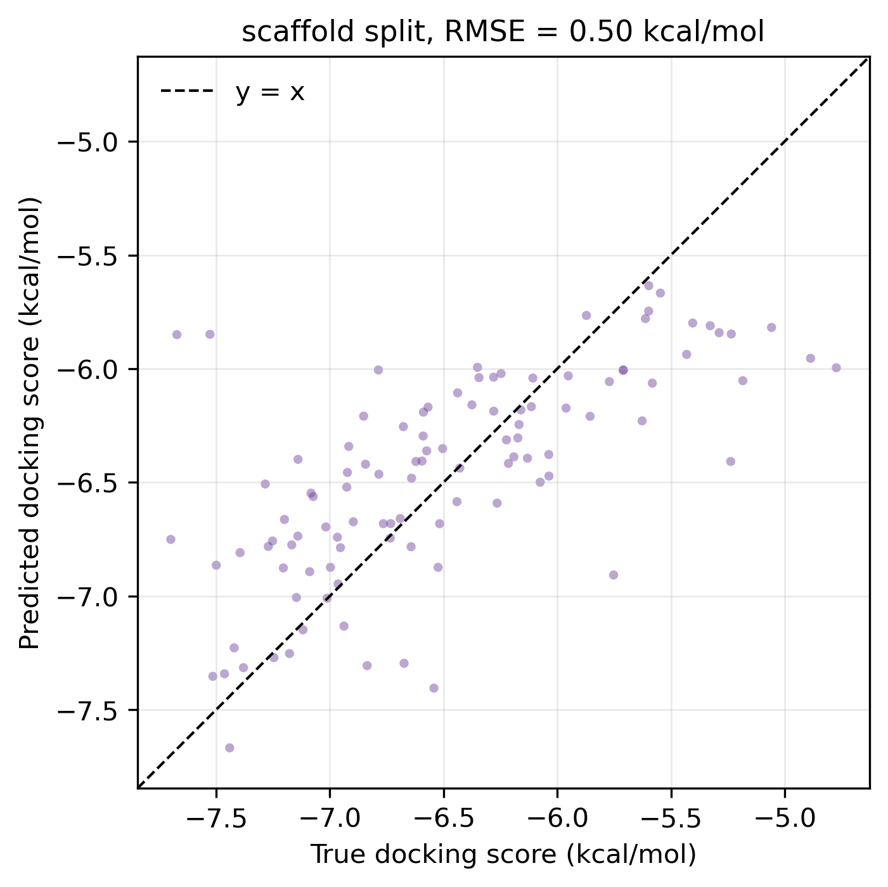
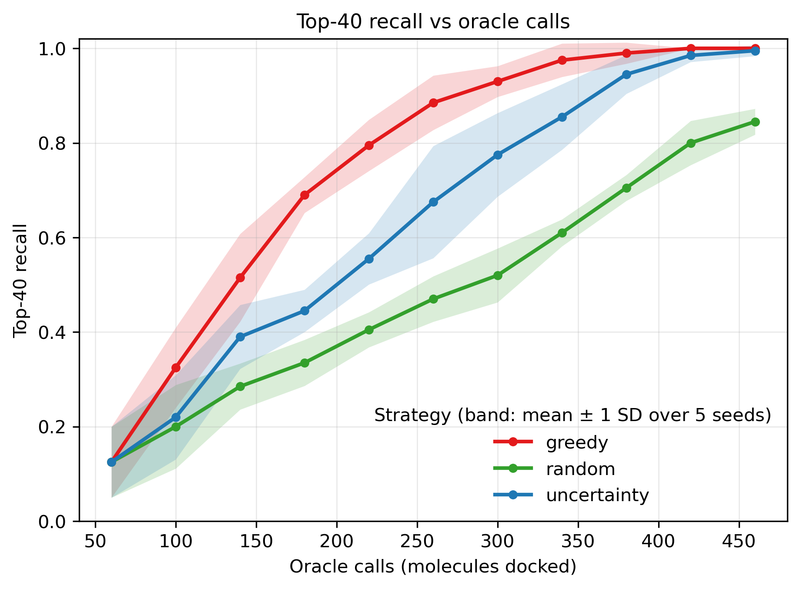
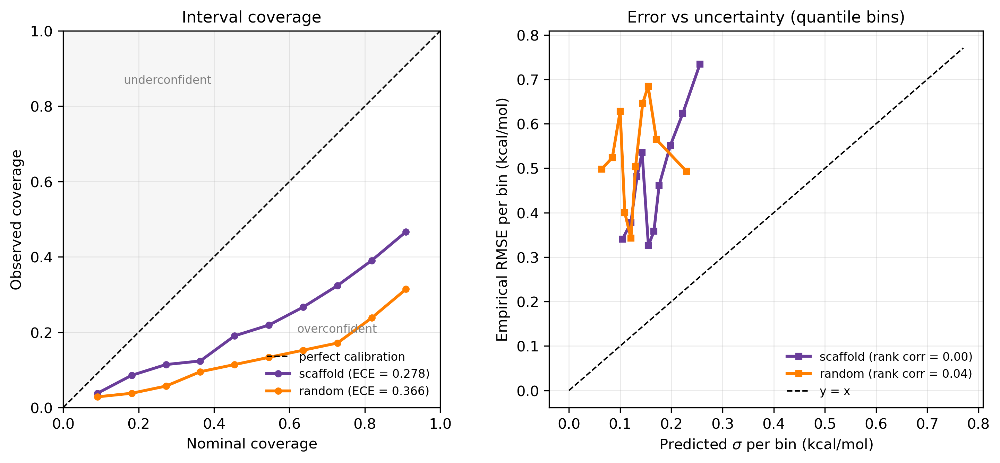

# docking-surrogate-al

[](https://github.com/Joana-Mansa/docking-surrogate-al/actions/workflows/ci.yml)

A graph neural network that predicts molecular docking scores, and an
uncertainty-guided active-learning loop that reaches the top-scoring compounds
in a library using fewer docking calls than random selection.

Docking is expensive: **126.7 CPU-seconds per molecule** measured here, so a
million-compound screen is CPU-months. This measures two things. How faithfully
can a GNN reproduce the docking oracle on unseen scaffolds, and how many oracle
calls does model-guided selection save against a random baseline.

On a 525-molecule pool, the surrogate reaches **Spearman 0.71 on a scaffold
split** (RMSE 0.50 kcal/mol against a target SD of 0.79), and model-guided
acquisition reaches 80% top-40 recall with **47% fewer oracle calls** than
random. The MC-dropout uncertainty estimates, measured rather than assumed,
turned out to be **badly calibrated and uninformative about error** - reported
below alongside the results they undercut.

> **Docking scores are not experimental binding affinities.** A surrogate that
> predicts docking well has learned to imitate docking, including its errors.
> This project makes no claim about real binding affinity or therapeutic
> relevance.

## Results

A **reduced run: 525 molecules** docked against trypsin 3PTB at exhaustiveness 8,
not the 5,000 the default config specifies. Docking measured **126.7 CPU-seconds
per molecule** (median 121.5), so the full pool is ~105 CPU-hours and did not fit
the machine-day available. Everything below is in [`results/cv_small/`](results/cv_small),
with the config hash, git commit and hardware in its `manifest.json`.

Scores span -9.05 to -4.77 kcal/mol (SD 0.79), and **0 of 525 were non-physical**.

### Surrogate fidelity

95% bootstrap CIs, 1000 resamples, n_test = 105.

| Metric | Scaffold split | Random split |
| --- | --- | --- |
| RMSE (kcal/mol) | 0.496 [0.406, 0.589] | 0.540 [0.455, 0.620] |
| MAE (kcal/mol) | 0.369 [0.311, 0.431] | 0.423 [0.358, 0.488] |
| Spearman rho | 0.714 [0.563, 0.833] | 0.741 [0.618, 0.830] |
| Precision@10 | 0.500 [0.100, 0.700] | 0.600 [0.300, 0.800] |
| Precision@50 | 0.820 [0.720, 0.880] | 0.740 [0.640, 0.840] |

A scaffold RMSE of 0.50 against a target SD of 0.79 means the surrogate captures
real variance rather than predicting the mean. The parity plot shows clear
regression to the mean: predictions span a narrower range than the truth, so the
model is conservative at both tails.



Scaffold and random come out close here, closer than the usual expectation that
scaffold is markedly harder. At 105 test molecules the confidence intervals
overlap heavily, so this run does not establish a gap in either direction.

**EF@1% and precision@100 are excluded from the table**, though both are in
`metrics.csv`. With 105 test molecules the top 1% is a single molecule, so EF@1%
can only take the value 0 or 100; its bootstrap CI came back [0, 0] and [0, 100].
Precision@100 asks for more molecules than the test set holds. Neither is
meaningful at this sample size, and quoting them would be dressing up noise.

### Active learning

Top-40 recall against oracle calls, 3 strategies x 5 seeds x 10 rounds, band is
mean +- 1 SD across seeds. 60 seed molecules, then 40 per round.



Oracle calls to reach a given recall, interpolated from the mean curves:

| Target recall | greedy | uncertainty | random |
| --- | --- | --- | --- |
| 50% | 137 (**52% fewer**) | 200 (**30% fewer**) | 284 |
| 80% | 222 (**47% fewer**) | 312 (**26% fewer**) | 420 |
| 90% | 273 | 360 | never reached |

Both active strategies beat random, and the bands separate cleanly through the
middle of the curve. Random does exactly what theory says it should: it recovers
close to the fraction of the pool it has labelled (0.845 recall at 460 calls,
which is 87.6% of the pool), which is why it is the baseline worth beating
rather than a formality.

**Greedy beats uncertainty, and that is expected rather than a surprise.**
Top-k recall rewards spending every call in the region the metric scores, which
is what greedy does by construction. Uncertainty sampling is trying to build a
better model, not to find good molecules, so it pays calls for information that
this particular metric does not reward. The two are reported separately rather
than collapsed into one "active learning wins" claim.

**One result here contradicts the calibration section above.** Given that
predicted sigma had essentially no rank correlation with error on held-out data
(0.002 and 0.038), uncertainty sampling had no obvious mechanism by which to
beat random, and it beat it comfortably. The two measurements are not strictly
comparable: the calibration numbers come from a model trained on 368 molecules
and scored on held-out test data, while acquisition ranks *unlabelled pool*
molecules using models trained on 60 to 460. Whatever the sigma ranking is
picking up on in that regime, this experiment does not establish what it is,
and the honest summary is that the uncertainty signal is useful for acquisition
while being uninformative about error magnitude.

**The budgets here are unusually large relative to the pool.** The curve spans
11% to 88% of the library labelled, because the pool is 525 molecules. A real
campaign labels a far smaller fraction, where every curve would sit in the
steep early region and the gaps between strategies would be the part that
matters. Treat the shape as indicative, not as a transferable saving.

### Calibration: the uncertainty does not work

The clearest result of this run is a negative one.

| | Scaffold | Random |
| --- | --- | --- |
| Expected calibration error | 0.278 | 0.366 |
| Miscalibration area | 0.230 | 0.303 |
| Spearman(sigma, abs error) | **0.002** | **0.038** |
| Mean predicted sigma | 0.168 | 0.131 |

Two things are wrong, and the second is the serious one.

The model is **overconfident by roughly 3x**: mean predicted sigma is 0.168 while
actual RMSE is 0.496. More importantly, predicted uncertainty has **no rank
correlation with actual error** (Spearman 0.002 and 0.038). The uncertainty
estimate is not merely mis-scaled, which recalibration would fix; it carries
almost no information about which predictions are wrong.

This is reported rather than buried because it is the measurement the calibration
code exists to make, and because it directly predicts the active-learning outcome
below: acquisition by an uncertainty signal that does not track error has no
mechanism by which to beat random selection.

Plausible causes, untested here: 525 molecules is small for MC-dropout to
separate epistemic uncertainty from noise, and dropout 0.15 may be too low to
produce meaningful predictive spread. A deep ensemble (`uncertainty.method:
ensemble`) is the obvious comparison and has not been run.



## Quickstart

```bash
git clone https://github.com/Joana-Mansa/docking-surrogate-al.git
cd docking-surrogate-al
uv sync                                    # GPU, CUDA 12.8
conda install -c conda-forge smina openbabel

export PYTHONPATH=src
for stage in prepare-data dock train evaluate run-al; do
  python -m docking_surrogate_al.cli $stage --config configs/smoke.yaml
done
```

The smoke config runs the whole pipeline on 200 molecules, CPU-only, no
network, in about seven minutes. It is what CI runs on every push. For a CPU
install use `requirements-cpu.txt`; `pyproject.toml` pins a CUDA build.

## Pipeline

```
prepare-data  ChEMBL download (or local CSV) -> RDKit standardisation
     |
   dock       smina against one target, parallel over CPU cores,
     |        every result cached by canonical SMILES
   train      GINE graph network, one model per split, AMP + checkpoints
     |
  evaluate    scaffold and random splits side by side, bootstrap CIs,
     |        calibration of the uncertainty estimates
  run-al      uncertainty / greedy / random acquisition, 10 rounds, 5 seeds
```

Five CLI entry points, one YAML config, no hardcoded paths or hyperparameters.
Any stage can be interrupted and rerun; it resumes from the last checkpoint.

```bash
python -m docking_surrogate_al.cli train --config configs/default.yaml \
  --set train.batch_size=256 --set uncertainty.mc_chunk=30
```

## Evaluation

Every metric is reported on **both** a Bemis-Murcko scaffold split and a random
split. The random split flatters the model; reporting only that number would be
the easy lie. A test asserts no scaffold appears on both sides of the boundary.

| | |
|---|---|
| Fidelity | RMSE, Spearman rho |
| Ranking | enrichment factor at 1% and 5%, precision@{10,50,100} |
| Uncertainty | reliability curve, ECE, error-vs-sigma correlation |
| Confidence | non-parametric paired bootstrap, 1000 resamples, 95% CI |

The bootstrap resamples molecules rather than residuals, which is what keeps
the rank metrics valid. Active learning runs 3 strategies x 5 seeds x 10
rounds, with the random baseline plotted in the same weight as the others.

## Design notes

- **The oracle is an interface.** smina is CPU-only; a CUDA backend (gnina)
  can be added without touching anything upstream. Nothing outside `oracle/`
  imports smina, and every cached score records which backend produced it.
- **The docking cache is an append-only log**, fsynced per record and keyed by
  `(canonical SMILES, settings fingerprint)`. Interrupted runs keep everything
  finished; changing the box or exhaustiveness starts a fresh partition instead
  of silently reusing stale scores.
- **Ligands are batched per smina call.** Receptor setup dominates per-molecule
  cost, so `oracle.ligand_batch_size` amortises it. Results are matched back by
  ligand name, never output order, because smina omits ligands it fails to
  dock. CI verifies batched and unbatched scores agree.
- **Dropout sits inside the encoder, not only the head**, so MC-dropout samples
  representation uncertainty rather than readout noise. Passes are batched into
  single forward calls with BatchNorm held in eval.
- **Positive docking scores are steric clashes, not weak binding.** Left in,
  a handful dominate the target scaler. `data.max_docking_score` excludes them
  at pool construction, the cache keeps what the oracle actually returned, and
  every run reports how many were dropped.
- **Standardisation is the cache key**, so it must be deterministic and
  idempotent. Both are asserted in tests.

## Hardware

`run.device` is `cuda`, `cpu` or `auto`, taken from config and never
hardcoded. `cuda` is a requirement: if CUDA is missing the run fails in the
first second with a message naming what torch sees. Only `auto` falls back, and
it logs that it did.

**CUDA 12.8**, pinned via `torch==2.9.1+cu128` from the PyTorch cu128 index.
Driver 525+ (Linux) or 528+ (Windows).

`configs/default.yaml` targets a ~6 GB card so a clean clone trains out of the
box; `configs/gpu_16gb.yaml` is the larger profile. Batch size, dataloader
workers and pin_memory are all config parameters.

Mixed precision defaults on, with gradients unscaled before clipping, and is
auto-disabled on CPU where bfloat16 autocast is slower than fp32.
`scripts/check_amp_parity.py` trains with AMP on and off across seeds and
compares the gap to seed-to-seed variance, so the "AMP changes nothing" claim
is checkable rather than asserted.

smina is CPU-only. `oracle.n_workers` is a CPU core count, defaulting to
`cpu_count() - 1`, and each invocation is pinned to `--cpu 1`.

## Outputs

Every run writes a manifest recording the config hash, git commit and dirty
flag, package versions, GPU name, VRAM, CUDA version, peak memory, throughput
and per-stage wall clock, so any result can be traced to what produced it.

```
runs/<name>/metrics.csv              one row per split and metric, with CIs
runs/<name>/active_learning.csv      one row per (strategy, seed, round)
runs/<name>/predictions_<split>.csv  per-molecule prediction and sigma
runs/<name>/manifest.json            provenance and hardware
figures/                             all figures at 300 dpi
cache/docking_cache.jsonl            every docking result, with its backend
```

## The target

Trypsin with benzamidine bound (PDB **3PTB**), box centred on the
co-crystallised ligand. Chosen for being small, fast to dock and a standard
docking validation system, not for therapeutic interest. Target, box and
exhaustiveness are config parameters.

## Testing

```bash
PYTHONPATH=src pytest tests -q        # 106 tests
```

Covers standardisation idempotence (it is the cache key), scaffold-split
leakage in both directions, every metric against hand-computed values,
calibration against synthetic calibrated and miscalibrated predictions,
acquisition strategies, the cache under simulated interruption, and
checkpoint/resume compared against an uninterrupted run rather than merely
checking a file loads.

CI runs the unit tests and, separately, the entire pipeline against a real
smina binary installed from conda-forge. It is an integration test, not a mock.

## Not implemented

Both of these raise a clear error rather than failing quietly:

- **Multi-GPU ensemble training** (`uncertainty.ddp`). DDP all-reduces
  gradients across ranks, which would converge ensemble members into one model
  and collapse the predictive spread the ensemble exists to measure. The right
  design is member-parallel, which could not be tested on a single-GPU machine,
  so it is specified in `models/ensemble.py` and left unshipped.
- **The gnina backend.** A documented stub showing where a CUDA-capable oracle
  would plug in.

## Limitations

- **One target, one box, one exhaustiveness.** Nothing here shows the approach
  transfers; docking surrogates are known to be target-specific.
- **The oracle is smina, not an experiment.** Reported fidelity is fidelity to
  smina, including its errors. No molecule has been synthesised or assayed.
- **Scaffold split is still optimistic.** Train and test molecules come from
  the same library, prepared the same way, docked against the same receptor.
  Prospective use means new chemistry from a different source.
- **Active learning is retrospective.** The pool is docked up front and an
  "oracle call" reveals a precomputed label. This makes 150 campaigns
  affordable but cannot discover molecules outside the pool, so the curves
  measure sample efficiency within a fixed library.
- **Clash scores are excluded, not modelled.** Metrics therefore describe
  molecules that dock at all, while a real campaign still pays for the ones
  that do not.
- **Uncertainty is epistemic only.** MC-dropout does not model the oracle's own
  variability, which is why calibration is measured rather than assumed.
- **Small chemical space.** A few thousand molecules is a narrow slice of
  drug-like space, and enrichment at 1% on a few hundred test molecules is
  coarse. `n_test` is reported alongside every metric so this stays visible.

## Licence

MIT. See [LICENSE](LICENSE).
